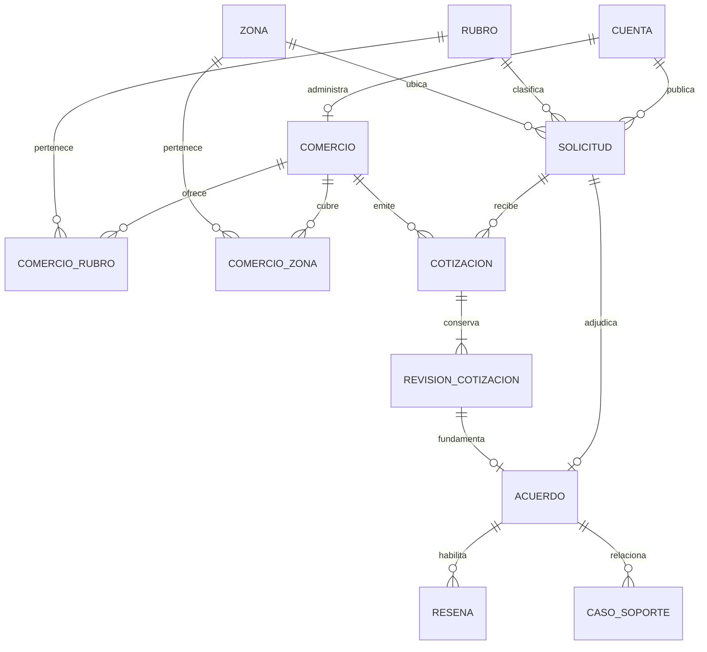

# Modelo de dominio, permisos y transacciones

**Borrador técnico v0.2 · Modelo lógico para la beta móvil**

La identidad se verifica por correo. Cada cuenta admitida representa a un comprador y puede estar asociada a un perfil de comercio aprobado. Operaciones usa permisos internos asignados por separado. La beta parte de un responsable por perfil de comercio como decisión propuesta. Cualquier función de varios empleados por comercio requiere definir membresías, permisos y transferencia de propiedad.

## Relaciones principales

| Registro | Claves y datos relevantes |
| --- | --- |
| Cuenta | Identificador interno y sujeto del proveedor de identidad únicos. Estado de acceso a la beta. El correo de acceso se mantiene separado del contacto comercial que se muestra tras aceptar. |
| Comercio y cobertura | Propietario único en la beta, estado `pending`, `approved`, `rejected` o `suspended`, datos de contacto, varios rubros y cobertura municipal completa o lista de zonas. Operaciones registra quién aprobó o suspendió y cuándo. |
| Rubro y zona | Códigos estables gestionados por operaciones. Una zona pertenece al catálogo de Galapa. Se permite un código provisional `OTHER` para sectores por clasificar. |
| Solicitud | Comprador, rubro, zona aproximada, tipo `product` o `service`, descripción, fecha requerida, estado, adjuntos y presupuesto privado opcional. Guarda cuándo se publicó y cuándo vence. |
| Cotización y revisión | Una cotización por pareja solicitud-comercio. Una secuencia única de revisiones por cotización. Cada revisión conserva descripción, modalidad, fecha prometida, precio, cargos, total y vigencia. |
| Acuerdo | Una fila por solicitud adjudicada. Apunta a la revisión aceptada y conserva las condiciones en una copia que sirve de historial. Tiene fechas de aceptación, confirmación o cancelación. |
| Reseña | Un registro por acuerdo y autor. Guarda destinatario, puntuación de 1 a 5, comentario opcional, fecha y estado de publicación. |
| Soporte, avisos y control | Casos y sus resoluciones, bloqueos entre cuentas, auditoría de operaciones, avisos en bandeja y eventos pendientes de entrega. Una solicitud de cancelación abierta por acuerdo como máximo. |

La base impone las restricciones únicas de acuerdo, cotización, revisión y reseña. La API verifica relaciones cruzadas, como que la revisión aceptada pertenezca a una cotización de la misma solicitud. Los archivos se guardan de forma privada y se autorizan según el recurso al que pertenecen. [Restricciones de PostgreSQL](https://www.postgresql.org/docs/current/ddl-constraints.html)

## Estados y transiciones

| Entidad | Desde | Acción y resultado |
| --- | --- | --- |
| Solicitud | `draft` | El comprador publica → `open`. |
| Solicitud | `open` | Se acepta una oferta → `awarded`. El comprador cancela → `cancelled`. Llega el vencimiento → `expired`. |
| Cotización | `active` | El proveedor cambia sus condiciones → nueva revisión. Puede retirar → `withdrawn`. Una oferta vencida → `expired`. |
| Cotización | `active` | Su revisión gana → `accepted`. Al cerrarse la solicitud, las demás ofertas activas → `closed`. Las ofertas retiradas o vencidas conservan su estado. |
| Acuerdo | `agreed` | El comprador confirma → `completed`. Operaciones acepta la cancelación → `cancelled`. |
| Caso de cancelación | `open` | Operaciones resuelve → `approved` o `rejected`. El rechazo deja el acuerdo en `agreed`. |

Si vence la vigencia, la API rechaza la acción en ese momento aunque el proceso de caducidad aún no haya actualizado el estado persistido. La comparación considera la revisión vigente de cada cotización. Al consultar el historial se preservan las versiones anteriores.

## Matriz de acceso

| Acción o dato | Comprador titular | Comercio elegible o participante | Operaciones |
| --- | --- | --- | --- |
| Borrador y presupuesto | Lee y edita su borrador. | Acceso restringido al comprador. | Acceso excepcional a datos privados según el permiso y el caso. |
| Solicitud abierta | Lee su solicitud y actúa sobre ella según el estado. | Ve descripción, rubro, zona aproximada, plazo y adjuntos autorizados si está aprobado y cubre rubro y zona. | Consulta según el caso. |
| Cotizaciones de una solicitud | Ve y compara las que recibe. | Ve y modifica su propia oferta según el estado. | Consulta y registra incidencias. |
| Acuerdo y condiciones | Consulta el acuerdo propio y el contacto comercial autorizado. | Consulta solo si fue elegido. | Consulta y resuelve cancelaciones según permiso. |
| Confirmación y reseñas | Confirma cumplimiento y envía su reseña. | Envía su reseña tras la confirmación. | Atiende reportes y modera con registro. |
| Cancelación posterior a aceptar | Abre un caso de soporte. | Puede reportar una incidencia. | Resuelve el caso y registra el motivo. |

Las consultas filtran por identidad, propiedad, estado y cobertura en servidor. Una cuenta con perfil comercial queda fuera de sus propias solicitudes. Los bloqueos en cualquiera de los dos sentidos impiden nuevas interacciones. Si las partes ya tienen un acuerdo, conservan sus condiciones e historial y soporte canaliza la coordinación. Los datos de contacto dejan de mostrarse en el acuerdo cuando el bloqueo o las reglas de moderación lo requieran. Los enlaces temporales a adjuntos se emiten después de verificar el acceso.

## Aceptación y acciones simultáneas

1. Validar la sesión y cargar la solicitud del comprador. Dentro de una transacción, bloquear primero la fila de solicitud y después la cotización. Usar el mismo orden al publicar o cambiar una oferta, retirar, cancelar y adjudicar cuando se modifique una cotización asociada.
2. Comprobar que la cotización corresponde a esa solicitud, que su número de revisión coincide con el confirmado, que ambas vigencias se cumplen con la hora del servidor y que el proveedor sigue habilitado. Si la revisión cambió, responder `409 OFFER_REVISION_CHANGED`. Si la vigencia acabó, responder el conflicto de vencimiento que corresponda.
3. Crear el acuerdo, adjudicar la solicitud, aceptar la oferta elegida y cerrar las demás activas en la misma transacción. Guardar allí también los eventos para los avisos. La restricción única de `agreement.request_id` protege contra duplicados.
4. Si el comprador repite la misma aceptación, devolver el acuerdo existente sin crear otro ni repetir avisos. Si intenta aceptar otra oferta después de adjudicar, devolver un conflicto. Los reintentos deben volver a verificar el acceso y calcular la vista de los datos que pueden mostrarse en ese momento.

Confirmar cumplimiento, abrir una solicitud de cancelación y resolverla deben serializarse sobre la fila del acuerdo. El proceso que envía avisos lee los eventos confirmados en la base, deduplica los avisos por evento y destinatario y reintenta la entrega push. La bandeja persiste aunque el envío push falle. [Bloqueos de filas en PostgreSQL](https://www.postgresql.org/docs/current/explicit-locking.html#LOCKING-ROWS)

## Registros operativos y privacidad

- Registrar hora, rubro, zona, cantidad de comercios elegibles y tipo de evento para medir primera oferta válida, segunda oferta de otro comercio, aceptación, cumplimiento y cancelación. Conservar los identificadores internos necesarios para deduplicar.
- Excluir descripciones, fotos, correos y contactos comerciales de eventos analíticos y logs generales. En auditoría de soporte, registrar actor, acción, entidad, fecha y motivo con acceso restringido.
- Mantener los datos del piloto asistido en su registro operativo. Antes de migrar cualquier dato individual, decidir su finalidad, autorización y retención. Usar el agregado del piloto para comparar resultados.
