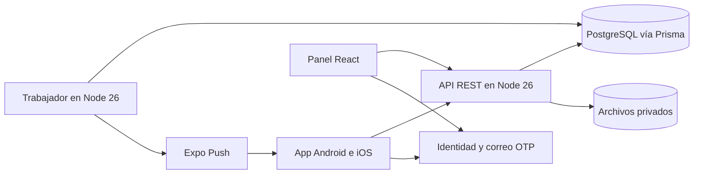

# Tecnologías y arquitectura

**Borrador técnico v0.3 · 13 de noviembre de 2026**

## Decisiones y versiones de referencia

| Componente | Decisión o propuesta | Verificación antes de adoptarlo |
| --- | --- | --- |
| Backend | **Confirmado:** Node.js 26 LTS con el último parche disponible y pnpm. TypeScript es la propuesta para el código del backend. Versiones publicadas verificadas al 13 de noviembre: **Node 26.13.1** y **pnpm 12.20.0**. | Fijar versiones exactas al iniciar y actualizar por revisión. Mismo Node y pnpm en desarrollo de backend, CI y contenedor. `pnpm-lock.yaml` versionado e instalación congelada en CI. Confirmar que la versión elegida se resuelve en el registro antes de fijarla. [Node 26.13.1](https://nodejs.org/en/blog/release/v26.13.1) · [pnpm 12.20.0](https://github.com/pnpm/pnpm/releases/tag/v12.20.0) · [Compatibilidad pnpm](https://pnpm.io/installation) |
| HTTP | **Propuesta:** Fastify estable con TypeScript, REST y OpenAPI. | Validación de entrada, esquemas de salida y logs estructurados facilitan mantener la separación entre presupuesto, contacto y datos públicos. Probar Fastify y sus plugins en Node 26. Express, sugerido en el primer borrador, sigue siendo viable si el equipo ya tiene infraestructura y experiencia para integrar esos controles. [Fastify](https://fastify.dev/docs/latest/Reference/Validation-and-Serialization/) · [Express](https://expressjs.com/en/advanced/best-practice-performance/) |
| Persistencia | **Prisma confirmado.** PostgreSQL administrado, con PostgreSQL 18 como candidato si el proveedor y el cliente elegido lo soportan en el plan contratado. | Evaluar Prisma 8 y la contingencia Prisma 7 con la prueba definida abajo. Validar conexiones, migraciones, respaldos y restauración. [PostgreSQL](https://www.postgresql.org/support/versioning/) · [Estado de Prisma ORM](https://www.prisma.io/docs/orm/release-status) |
| App móvil | **Propuesta:** React Native + Expo + TypeScript, Expo Router y TanStack Query para datos remotos. Expo SDK 58 documenta React Native 0.88 y React 19.3. | Tomar el parche estable que indique Expo al iniciar y probar builds de Android e iOS, OTP, sesión, cámara o galería, avisos y enlaces. La herramienta de compilación móvil puede usar la versión de Node admitida por Expo y EAS, independientemente del runtime del backend. [Matriz de Expo SDK](https://docs.expo.dev/versions/latest/) · [Expo Router](https://docs.expo.dev/router/introduction/) · [TanStack Query en React Native](https://tanstack.com/query/latest/docs/framework/react/react-native) |
| Panel interno | **Propuesta:** React, TypeScript y Vite. | La interfaz es operativa y autenticada. Una SPA consume la misma API, con permisos internos y sesión de navegador diseñados para el panel. Si aparece una web pública con requisitos de indexación o renderizado en servidor, se puede evaluar Next.js para ese frente. [Vite](https://vite.dev/guide/) |
| Infraestructura | **Confirmado:** servicios administrados, con presupuesto por definir. | Cotizar dos entornos, trabajadores, base, correo, archivos, copias y observabilidad. Medir latencia desde Colombia, revisar regiones, portabilidad y condiciones de respaldo. |

React Native con Expo encaja con el alcance porque el equipo puede trabajar en TypeScript en móvil, web y backend, compartir contratos de API y distribuir una app para ambos sistemas. Flutter también cubre ambos sistemas, con Dart y su propio conjunto de componentes. Sería una alternativa si el equipo domina Dart o si una prueba en dispositivos muestra una necesidad concreta que cambie la decisión. La propuesta mantiene interfaces propias para móvil y panel y comparte tipos y el cliente HTTP. [Arquitectura de Flutter](https://docs.flutter.dev/resources/architectural-overview) · [Guía de monorepos de Expo](https://docs.expo.dev/guides/monorepos/)

## Decisión de Prisma con Node 26

La documentación de Prisma indica que `latest` apunta a **Prisma 8 candidato** y que esa línea admite Node 26. La última versión estable de la línea 7 encontrada es **7.10.1**. Su página declara una política general de soporte para Node LTS y su tabla específica enumera Node 20, 22 y 24. Para usar Prisma 7 como contingencia se debe verificar la instalación y el alcance del soporte con Node 26. En Prisma 8 para PostgreSQL, la CLI `prisma` y `@prisma/orm-postgres` tienen versiones independientes. En Prisma 7 se alinean `prisma` y `@prisma/client` y se usa la configuración de esa línea. [Estado de Prisma](https://www.prisma.io/docs/orm/release-status) · [Versiones de Prisma 8](https://www.prisma.io/docs/orm/supported-versions) · [Requisitos de Prisma 7](https://www.prisma.io/docs/orm/v7/reference/system-requirements) · [Prisma 7.10.1](https://github.com/prisma/orm/releases/tag/7.10.1)

| Prueba en Linux con Node 26 y PostgreSQL de destino | Evidencia esperada para decidir |
| --- | --- |
| Instalación limpia y compilación | Registrar versiones exactas, comandos de la línea elegida y arranque en la imagen de despliegue. |
| Migraciones | Crear desde cero, aplicar un cambio aditivo y probar actualización sobre una base con datos sintéticos. Verificar migraciones fallidas y restauración sin tocar producción. |
| Consistencia | Bloqueo de fila o escritura condicional dentro de una transacción, rollback de acuerdo y evento, restricción única, mapeo de error y repetición después de perder la respuesta. |
| Consultas y conexiones | Lecturas paginadas, tiempos de espera y cierre de conexiones. Medir API y trabajador en paralelo con los límites del proveedor. |

Evaluar primero la línea 8 y comprobar su estado oficial al decidir. Si sigue en RC o no cubre el recorrido, probar Prisma 7.10.1 en Node 26 como contingencia. Un resultado verde demuestra funcionamiento en ese entorno, mientras el alcance del soporte oficial se verifica por separado. Registrar en una decisión de arquitectura la versión elegida, los resultados y el riesgo que se acepta si sigue siendo RC o si Node 26 no está declarado para esa línea. Si ambas opciones fallan, escalar la decisión al equipo y mantener Node 26 como requisito del proyecto. Los procedimientos de migración se escriben después de escoger la línea. [Transacciones de Prisma 8](https://www.prisma.io/docs/orm/reference/transactions-and-runtime) · [Cambios entre Prisma 7 y 8](https://www.prisma.io/docs/orm/coming-from-prisma-orm-7)

## Diseño de ejecución

Usar un **monolito modular**. La API y el trabajador se pueden desplegar como dos procesos del mismo repositorio y compartir los módulos y la base. La API atiende peticiones HTTP. El trabajador procesa eventos persistentes, vencimientos y avisos. Los módulos son identidad y admisión, comercios y catálogo, solicitudes, cotizaciones, acuerdos y soporte, reputación, avisos y moderación. Cada módulo concentra sus reglas y expone casos de uso. Los manejadores HTTP validan, autentican, invocan el caso de uso y proyectan la respuesta. Prisma y los servicios externos se usan desde el servidor.

Propuesta de organización del workspace pnpm para cuando se implemente. `apps/mobile`, `apps/admin` y `apps/api` contienen las tres aplicaciones. El trabajador puede empezar como segundo punto de entrada de `apps/api`. `packages/api-client` contiene el cliente y los tipos derivados del contrato. Los modelos de Prisma, secretos y reglas de autorización permanecen dentro del backend. Las librerías de estado remoto se encargan de caché e invalidación de lecturas, con confirmación del servidor para publicar, aceptar, completar y cancelar.

| Referente | Patrón que se adopta |
| --- | --- |
| Sharetribe | Modelar cotización y cierre como transiciones con actor y estado, incluidos equipo de soporte y vencimiento automático. Su flujo inverso admite otros pasos como pagos o contraofertas, que en este proyecto tienen su propia fase. [Procesos de Sharetribe](https://www.sharetribe.com/docs/concepts/transactions/transaction-process/) · [Cotización inversa](https://www.sharetribe.com/help/en/articles/12266263-how-reverse-price-negotiation-transactions-work) |
| Medusa | Organizar comercio, módulos e integraciones por responsabilidad. Aquí las reglas de adjudicación se conservan en una sola transacción PostgreSQL. [Arquitectura de Medusa](https://docs.medusajs.com/learn/introduction/architecture) |
| AWS Prescriptive Guidance | Guardar el evento en la misma transacción que el cambio comercial y procesarlo después. El trabajador tolera entregas repetidas. [Transactional outbox](https://docs.aws.amazon.com/prescriptive-guidance/latest/cloud-design-patterns/transactional-outbox.html) |

## Candidatos de despliegue administrado

Propuesta inicial para comparar. **Render** para la API y un trabajador administrado, **Supabase** como candidato para PostgreSQL, identidad y archivos privados, y **Expo** para compilar, distribuir y enviar push. Revisar qué regiones son compatibles para ubicar API y base cerca entre sí, medir desde Galapa y confirmar el presupuesto. Cloud Run también es candidato si el equipo usa Google Cloud. En ese caso hay que documentar cómo se ejecutarán los procesos en segundo plano y sus costos. [Render Background Workers](https://render.com/docs/background-workers) · [Regiones de Render](https://render.com/docs/regions) · [Cloud Run](https://docs.cloud.google.com/run/docs/overview/what-is-cloud-run) · [Supabase y Prisma](https://supabase.com/docs/guides/database/prisma)

Separar desarrollo, beta y producción en credenciales, datos, buckets, apps y destinos de avisos. Mantener copias y cuentas de servicio bajo titularidad del equipo. La API usa una identidad de base con permisos de aplicación. Las migraciones usan otra credencial con permisos específicos y la conexión que indique el proveedor. Definir capacidad de conexión entre réplicas y trabajador antes de ampliar instancias. En beta, probar recepción de OTP con dominio de correo del proyecto y SMTP propio del servicio contratado. [OTP por correo](https://supabase.com/docs/guides/auth/auth-email-passwordless) · [SMTP en Supabase](https://supabase.com/docs/guides/auth/auth-smtp)

Para comparar presupuestos, estimar por separado el mínimo mensual de API, trabajador y base en cada ambiente, y el consumo variable de correo, almacenamiento, transferencia, builds y telemetría. Registrar qué incluye el respaldo del plan, cuánto cuesta restaurar y si el almacenamiento de fotos requiere su propia copia. Acordar un tope con el equipo antes de contratar.

Continúa en [seguridad](09-seguridad-y-privacidad.md), [solicitudes y rutas](10-solicitudes-rutas-y-procesos.md) y [rendimiento y operación](11-rendimiento-y-operacion.md).
